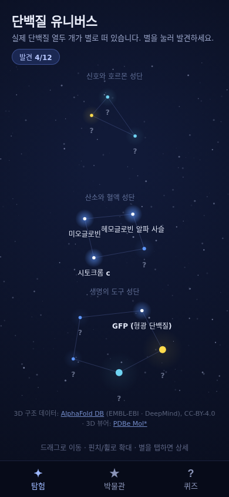

# 단백질 유니버스 (Protein Universe)

실제 AlphaFold 예측 구조 열두 개를 밤하늘의 별로 띄운 모바일 웹 앱입니다.
별을 탐험하고, 박물관에 모으고, 퀴즈로 확인하는 세 가지 놀이를 한 화면에서 즐길 수 있습니다.

- **데이터**: [AlphaFold Protein Structure Database](https://alphafold.ebi.ac.uk/) (EMBL-EBI · DeepMind, CC-BY-4.0)
- **3D 뷰어**: [PDBe Mol*](https://github.com/molstar/molstar) (Apache-2.0)
- **외부 유료 서비스 없음**: GPU·유료 API·CDN 의존 없이 정적 파일만으로 동작

## 주요 기능

### 1. 탐험 (우주 지도)
- 열두 개의 단백질이 3개의 별자리(신호와 호르몬 성단, 산소와 혈액 성단, 생명의 도구 성단)로 배치
- 드래그로 이동, 핀치/휠로 확대·축소, 별을 탭하면 상세 페이지로 이동
- 아직 발견하지 않은 별은 `?`로 표시, 발견한 별은 이름이 밝게 빛남

### 2. 상세 (3D 구조)
- 실제 AlphaFold 예측 모델(.cif)을 로컬 파일에서 불러와 카툰 형태로 표시
- 색상은 예측 신뢰도(pLDDT): 파랑 계열이 높고 노랑·주황 계열이 낮은 영역
- 각 단백질의 역할·이야기·주의점(전구체, 단일 사슬, apo 상태 등)을 한국어로 설명
- "별 발견 등록"을 누르면 박물관에 전시됨 (브라우저 localStorage에 저장)

### 3. 박물관 (컬렉션)
- 발견한 단백질이 전시 카드로 모이는 수집 화면 (n/12 진행률 표시)
- 미발견 항목은 실루엣으로만 표시

### 4. 퀴즈
- 화면에 무작위 단백질의 실제 3D 구조가 표시되고, 네 가지 이름 중 정답을 맞추는 게임
- 연속 정답 스트릭과 최고 기록 저장, 발견한 별만 출제하도록 범위 선택 가능
- 오답 시 정답 공개 + 짧은 해설

## 스크린샷

| 탐험 (우주) | 상세 (Cas9) | 박물관 | 퀴즈 |
|---|---|---|---|
|  |  |  |  |

## 수록 단백질 (12종)

| 별자리 | 단백질 | UniProt | pLDDT |
|---|---|---|---|
| 신호와 호르몬 | 인슐린 전구체 | P01308 | 52.9 |
| 신호와 호르몬 | 성장호르몬 | P01241 | 79.3 |
| 신호와 호르몬 | 알부민 | P02768 | 92.7 |
| 신호와 호르몬 | p53 | P04637 | 75.1 |
| 산소와 혈액 | 미오글로빈 | P02144 | 97.2 |
| 산소와 혈액 | 헤모글로빈 알파 사슬 | P69905 | 98.1 |
| 산소와 혈액 | 시토크롬 c | P99999 | 97.9 |
| 산소와 혈액 | 코로나19 스파이크 | P0DTC2 | 67.1 |
| 생명의 도구 | 리소자임 | P61626 | 94.1 |
| 생명의 도구 | GFP (형광 단백질) | P42212 | 96.6 |
| 생명의 도구 | Cas9 | Q99ZW2 | 88.4 |
| 생명의 도구 | 액틴 | P60709 | 95.2 |

pLDDT는 AlphaFold의 자체 신뢰도 점수(0-100)이며, 낮다고 해서 틀렸다는 뜻은 아닙니다
(인슐린 전구체처럼 원래 유연한 영역이 많은 단백질은 점수가 낮게 나옵니다).

## 실행 방법

정적 사이트라 빌드가 필요 없습니다. 로컬에서 보려면:

```bash
python3 -m http.server 8000
# http://localhost:8000 접속
```

3D 구조 파일(.cif)을 fetch로 불러오므로 파일을 직접 열면 동작하지 않고,
위처럼 로컬 서버나 GitHub Pages 같은 정적 호스팅이 필요합니다.

## 기술 상세

- **언어/프레임워크**: 순수 HTML + CSS + JavaScript (빌드 단계 없음)
- **라우팅**: 해시 기반 SPA (`#/`, `#/p/:acc`, `#/museum`, `#/quiz`)
- **우주 지도**: Canvas 2D. 월드 좌표(1000×1500)를 화면에 투영하고 포인터 이벤트로 팬/줌 처리. 별자리 선과 성운 그라데이션, 반짝이는 배경 별은 매 프레임 그림
- **3D 렌더링**: `pdbe-molstar` 웹 컴포넌트 v3.3.0을 vendor로 내장. `custom-data-url`로 로컬 .cif를 읽고 `alphafold-view` 프리셋으로 pLDDT 색상 적용
- **진행 저장**: 발견 목록·퀴즈 최고 기록을 localStorage에 저장 (계정·서버 불필요)
- **구조 데이터**: AlphaFold DB API(`https://alphafold.ebi.ac.uk/api/prediction/<ACC>`)로 확인한 다운로드 URL에서 .cif를 받아 `assets/structures/`에 내장 (총 5.7MB). 실행 시 외부 네트워크 요청 없음

### 디렉터리 구조

```
index.html                  셸 + 하단 탭 바
src/app.js                  라우터, 우주 캔버스, 상세/박물관/퀴즈 화면
src/data.js                 12개 단백질 메타데이터 (한국어 설명 포함)
src/style.css               스타일 (모바일 우선)
vendor/pdbe-molstar-component.js   PDBe Mol* 웹 컴포넌트 v3.3.0
assets/structures/*.cif     AlphaFold 예측 구조 12개
docs/screenshots/           README용 화면 캡처
```

## 라이선스 및 출처

- 3D 구조 데이터: AlphaFold Protein Structure Database, EMBL-EBI · DeepMind, [CC-BY-4.0](https://creativecommons.org/licenses/by/4.0/)
- 3D 뷰어: [Mol*](https://molstar.org/) / [pdbe-molstar](https://github.com/molstar/pdbe-molstar), Apache-2.0
- AlphaFold 구조는 실험으로 결정된 구조가 아니라 **예측 모델**입니다. 정확한 구조 정보가 필요하면 PDB의 실험 구조를 확인하세요.
