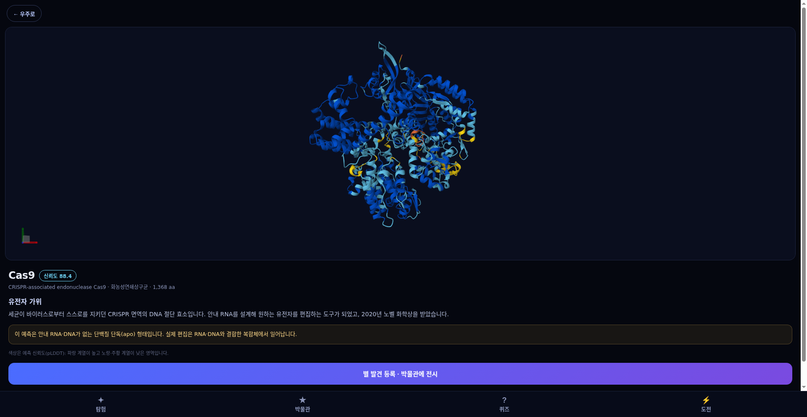
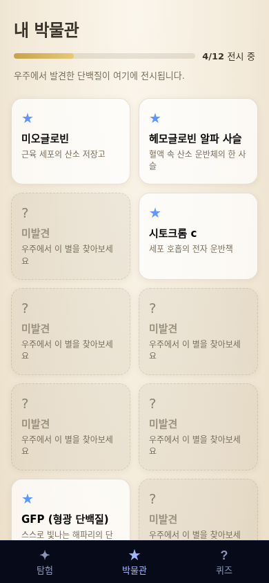
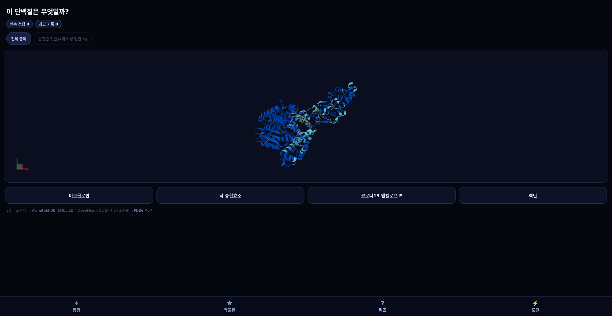
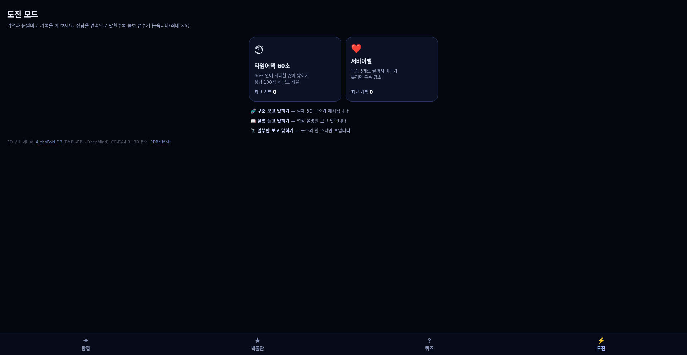
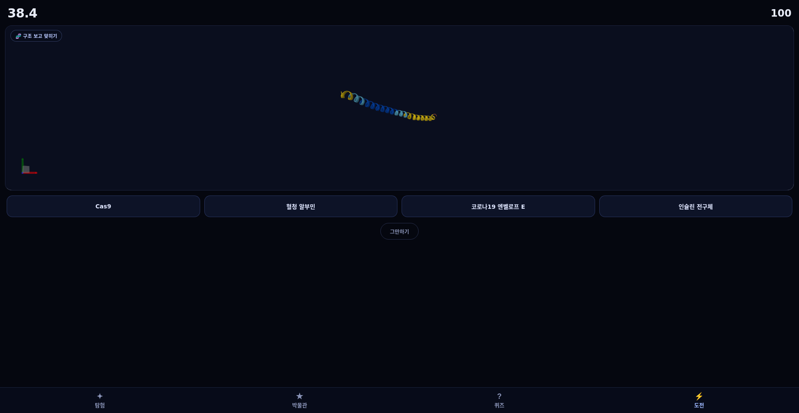
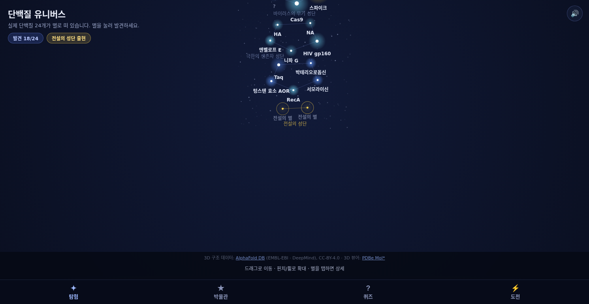

# 단백질 유니버스 (Protein Universe)

실제 AlphaFold 예측 구조 스물네 개를 밤하늘의 별로 띄운 모바일 웹 앱입니다.
별을 탐험하고, 박물관에 모으고, 퀴즈와 도전 모드로 확인하는 네 가지 놀이를 한 화면에서 즐길 수 있습니다.

- **데이터**: [AlphaFold Protein Structure Database](https://alphafold.ebi.ac.uk/) (EMBL-EBI · DeepMind, CC-BY-4.0)
- **3D 뷰어**: [PDBe Mol*](https://github.com/molstar/molstar) (Apache-2.0)
- **외부 유료 서비스 없음**: GPU·유료 API·CDN 의존 없이 정적 파일만으로 동작

## 주요 기능

### 1. 탐험 (우주 지도)
- 스물네 개의 단백질이 6개의 별자리(신호와 호르몬, 산소와 혈액, 생명의 도구, 바이러스의 무기, 극한의 생존자, 전설의 성단)로 배치
- 드래그로 이동, 핀치/휠로 확대·축소, 별을 탭하면 상세 페이지로 이동
- 아직 발견하지 않은 별은 `?`로 표시, 발견한 별은 이름이 밝게 빛남
- **숨은 전설의 별**: 전설을 제외한 별 18개를 발견하면 지도 아래쪽에 전설의 성단(루비스코·아쿠아포린-1)이 금색 맥동과 함께 나타남

### 2. 상세 (3D 구조)
- 실제 AlphaFold 예측 모델(.cif)을 로컬 파일에서 불러와 카툰 형태로 표시
- 색상은 예측 신뢰도(pLDDT): 파랑 계열이 높고 노랑·주황 계열이 낮은 영역
- 각 단백질의 역할·이야기·주의점(전구체, 단일 사슬, apo 상태 등)을 한국어로 설명
- "별 발견 등록"을 누르면 **별빛 폭발 이펙트와 효과음**과 함께 박물관에 전시됨 (브라우저 localStorage에 저장)
- 발견 수가 마일스톤(6/12/18/24개)에 닿으면 색종이 축하 연출, 18개에서 전설의 성단 해금

### 3. 박물관 (컬렉션)
- 발견한 단백질이 전시 카드로 모이는 수집 화면 (n/24 진행률 표시)
- 미발견 항목은 실루엣으로만 표시, 전설의 별은 해금 전까지 금색 봉인 카드로 표시
- 갓 전시된 항목은 NEW 배지와 등장 애니메이션으로 표시

### 4. 퀴즈
- 화면에 무작위 단백질의 실제 3D 구조가 표시되고, 네 가지 이름 중 정답을 맞추는 게임
- 연속 정답 스트릭과 최고 기록 저장, 발견한 별만 출제하도록 범위 선택 가능
- 정답·오답 효과음, 오답 시 정답 공개 + 짧은 해설

### 5. 도전 모드
- **타임어택 60초**: 제한 시간 안에 최대한 많이 맞히기. 정답 100점에 연속 정답 콤보 배율(최대 ×5)
- **서바이벌**: 목숨 3개로 끝까지 버티기. 틀리면 목숨 감소
- 세 가지 문제 유형이 무작위로 섞여 출제:
  - 🧬 구조 보고 맞히기 — 실제 3D 구조 제시
  - 📖 설명 읽고 맞히기 — 역할 설명만 보고 판단
  - 🔭 일부만 보고 맞히기 — 구조의 한 조각만 원형 창으로 공개
- 모드별 최고 기록 저장, 신기록 달성 시 축하 연출
- 다음 문제의 3D 구조를 미리 불러와(프리로드) 문제 전환이 빠름

효과음은 모두 WebAudio로 실시간 합성되며(외부 파일 없음), 우주 지도 우측 상단 버튼으로 끄고 켤 수 있습니다.

## 스크린샷

| 탐험 (우주) | 상세 (Cas9) | 박물관 | 퀴즈 |
|---|---|---|---|
|  |  |  |  |

| 도전 모드 | 타임어택 (부분 구조) | 전설의 성단 |
|---|---|---|
|  |  |  |

## 수록 단백질 (24종)

| 별자리 | 단백질 | UniProt | pLDDT |
|---|---|---|---|
| 신호와 호르몬 | 인슐린 전구체 | P01308 | 52.9 |
| 신호와 호르몬 | 성장호르몬 | P01241 | 79.3 |
| 신호와 호르몬 | p53 | P04637 | 75.1 |
| 산소와 혈액 | 미오글로빈 | P02144 | 97.2 |
| 산소와 혈액 | 헤모글로빈 알파 사슬 | P69905 | 98.1 |
| 산소와 혈액 | 혈청 알부민 | P02768 | 92.7 |
| 산소와 혈액 | 시토크롬 c | P99999 | 97.9 |
| 생명의 도구 | 리소자임 | P61626 | 94.1 |
| 생명의 도구 | GFP (형광 단백질) | P42212 | 96.6 |
| 생명의 도구 | 코로나19 스파이크 | P0DTC2 | 67.1 |
| 생명의 도구 | Cas9 | Q99ZW2 | 88.4 |
| 생명의 도구 | 액틴 | P60709 | 95.2 |
| 바이러스의 무기 | 헤마글루티닌 (독감) | P03452 | 77.7 |
| 바이러스의 무기 | 뉴라미니다제 (독감) | P03468 | 86.4 |
| 바이러스의 무기 | HIV 엔벨로프 gp160 | P04578 | 72.1 |
| 바이러스의 무기 | 니파 바이러스 G 당단백질 | Q9IH62 | 81.6 |
| 바이러스의 무기 | 코로나19 엔벨로프 E | P0DTC4 | 75.8 |
| 극한의 생존자 | 탁 중합효소 (Taq) | P19821 | 91.4 |
| 극한의 생존자 | 박테리오로돕신 | P02945 | 91.7 |
| 극한의 생존자 | 서모라이신 | P00800 | 92.0 |
| 극한의 생존자 | RecA (방사선 생존자) | P42443 | 88.8 |
| 극한의 생존자 | 텅스텐 함유 산화환원효소 | Q51739 | 98.1 |
| 전설 (숨은 별) | 루비스코 대형 사슬 | P00875 | 97.0 |
| 전설 (숨은 별) | 아쿠아포린-1 | P29972 | 90.8 |

pLDDT는 AlphaFold의 자체 신뢰도 점수(0-100)이며, 낮다고 해서 틀렸다는 뜻은 아닙니다
(인슐린 전구체처럼 원래 유연한 영역이 많은 단백질은 점수가 낮게 나옵니다).

## 실행 방법

정적 사이트라 빌드가 필요 없습니다. 로컬에서 보려면:

```bash
python3 -m http.server 8000
# http://localhost:8000 접속
```

3D 구조 파일(.cif)을 fetch로 불러오므로 파일을 직접 열면 동작하지 않고,
위처럼 로컬 서버나 GitHub Pages 같은 정적 호스팅이 필요합니다.

## 기술 상세

- **언어/프레임워크**: 순수 HTML + CSS + JavaScript (빌드 단계 없음)
- **라우팅**: 해시 기반 SPA (`#/`, `#/p/:acc`, `#/museum`, `#/quiz`, `#/challenge`)
- **우주 지도**: Canvas 2D. 월드 좌표(1000×2400)를 화면에 투영하고 포인터 이벤트로 팬/줌 처리. 별자리 선과 성운 그라데이션, 반짝이는 배경 별은 매 프레임 그림
- **3D 렌더링**: `pdbe-molstar` 웹 컴포넌트 v3.3.0을 vendor로 내장. `custom-data-url`로 로컬 .cif를 읽고 `alphafold-view` 프리셋으로 pLDDT 색상 적용. 도전 모드에서는 두 개의 뷰어 슬롯을 번갈아 쓰며 다음 문제를 프리로드
- **이펙트/사운드**: 별빛 폭발·색종이 파티클은 별도 Canvas 오버레이, 효과음은 WebAudio 오실레이터 합성 (외부 에셋 없음)
- **진행 저장**: 발견 목록·퀴즈/도전 최고 기록·전설 해금 여부·음소거 설정을 localStorage에 저장 (계정·서버 불필요)
- **구조 데이터**: AlphaFold DB API(`https://alphafold.ebi.ac.uk/api/prediction/<ACC>`)로 확인한 다운로드 URL에서 .cif를 받아 `assets/structures/`에 내장 (총 12MB). 실행 시 외부 네트워크 요청 없음
- **pLDDT 계산**: 각 .cif의 잔기별 pLDDT(B-factor 열) 평균을 직접 계산해 표기

### 디렉터리 구조

```
index.html                  셸 + 하단 탭 바
src/app.js                  라우터, 우주 캔버스, 상세/박물관/퀴즈/도전 화면, 이펙트·사운드
src/data.js                 24개 단백질 메타데이터 (한국어 설명 포함)
src/style.css               스타일 (모바일 우선)
vendor/pdbe-molstar-component.js   PDBe Mol* 웹 컴포넌트 v3.3.0
assets/structures/*.cif     AlphaFold 예측 구조 24개
docs/screenshots/           README용 화면 캡처
```

## 라이선스 및 출처

- 3D 구조 데이터: AlphaFold Protein Structure Database, EMBL-EBI · DeepMind, [CC-BY-4.0](https://creativecommons.org/licenses/by/4.0/)
- 3D 뷰어: [Mol*](https://molstar.org/) / [pdbe-molstar](https://github.com/molstar/pdbe-molstar), Apache-2.0
- AlphaFold 구조는 실험으로 결정된 구조가 아니라 **예측 모델**입니다. 정확한 구조 정보가 필요하면 PDB의 실험 구조를 확인하세요.
